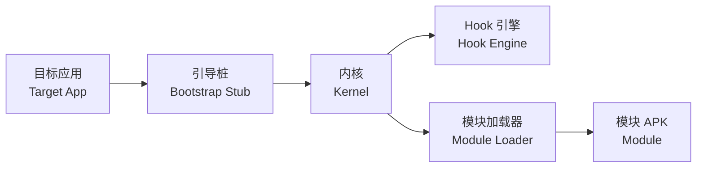

# XPatch

<p align="center">
  <b>免 Root 的 Android 模块加载框架</b><br/>
  <i>Rootless module loading framework for Android</i>
</p>

<p align="center">
  <a href="#-兼容性"></a>
  <a href="#-致谢"></a>
  <a href="#-构建"></a>
  <a href="#-构建"></a>
  <a href="LICENSE"></a>
  <a href="#-状态"></a>
  <a href="CONTRIBUTING.md"></a>
</p>

<p align="center">
  <a href="README.md">简体中文</a> ·
  <a href="docs/README.en.md">English</a> ·
  <a href="docs/README.zh-TW.md">繁體中文</a> ·
  <a href="docs/README.ja.md">日本語</a>
</p>

---

XPatch 让应用在不 Root、不刷机、不安装 Magisk / LSPosed 的前提下加载 Xposed 风格模块：
把模块入口注入目标应用，在内核启动的最早时机接管类加载与方法调用。

兼容 **Android 10 ~ 17**。

## ✨ 特性

| | |
|---|---|
| **免 Root** | 注入发生在重打包后的应用内，不依赖任何提权组件；可选接入 Shizuku 作为安装通道 |
| **原位注入** | 采用 zip 原位替换（In-place patching），只改写受影响条目，不重建整个 APK；产物体积与原包基本一致 |
| **覆盖安装** | 支持与其它补丁方案共存迁移，剥离旧注入层后按同一签名重签，安装即覆盖，本地数据保留 |
| **完整模块能力** | Java / Native 方法 Hook、deopt、模块自带原生库与资源 |
| **多进程安全** | 主进程与子进程并发初始化互不破坏 |
| **可验证** | 内置 ART 离线校验探针，安装前即可确认产物能被系统接受 |

## 🔧 工作原理



内核以内存加载方式启动（不落盘），随后挂载 Hook 引擎并重建模块类加载器。

## 📱 兼容性

| 项目 | 范围 |
|---|---|
| Android | 10 ~ 17 |
| ABI | arm64-v8a / armeabi-v7a / x86_64 / x86 |
| 模块 API | Legacy Xposed API · Modern API (libxposed) |
| 安装通道 | 常规安装 · Shizuku |

## 🚀 快速开始

1. 安装管理器（Manager）APK；
2. 选择目标应用，按需配置模块作用域（Scope）；
3. 注入并安装 —— 已由其它方案注入过的应用会自动剥离旧层后重签覆盖。

## 📂 仓库结构

```
XPatch/
├── runtime/          # 内核源码（Java + smali）
├── manager/          # 管理器：stub 引导桩 + Compose 应用
├── tools/            # 注入、签名、交付门禁、dex 校验
├── docs/             # 架构、构建、兼容性、模块 API、多语言说明
└── build/            # 构建产物（不入库）
```

## 🛠 构建

```powershell
# 编译内核
./runtime/build-java.ps1

# 注入并签名
python ./tools/repack.py app-base.apk build/classes.dex
./tools/sign.ps1 -In build/app-repacked.apk -Out build/app-signed.apk `
    -Keystore ./release.p12 -Alias release
```

依赖 Android SDK、JDK 17+ 与 Gradle。详见 [`docs/build.md`](docs/build.md)。

## 📊 状态

| 组件 | 状态 |
|---|---|
| 内核（Kernel） | 稳定 · Android 17 真机验证 |
| Hook 引擎 | 稳定 |
| 模块加载器（类 / 资源 / 原生库） | 稳定 |
| 管理器（注入 / 作用域 / 签名 / 日志） | 稳定 |

## 🙏 致谢

XPatch 的内核基于 **FPA**（`fun.fpa`）的架构与实现；同时受益于 LSPatch、NPatch、LSPosed、
Dobby、LSPlant、XposedBridge、libxposed、AndroidLiquidGlass、Miuix、Shizuku 等开源项目。

完整清单、许可与修改说明见 [`ACKNOWLEDGEMENTS.md`](ACKNOWLEDGEMENTS.md)。

## ⚖️ 许可与声明

- 本项目自身代码以 **MIT** 发布，全文见 [`LICENSE`](LICENSE)；
- 内核与部分组件来自第三方，版权归各自作者，**不在本项目 MIT 授权范围内**，详见致谢清单；
- 本项目为个人技术研究项目，与 Google、LSPosed、LSPatch、NPatch、FPA 官方均无隶属关系；
- 若您是权利人，认为本项目包含未获授权的内容，请邮件联系 **3069670151@qq.com**，
  我们会在核实后尽快处理（下架 / 补充署名 / 替换实现）。

<div align="center"><sub>Made with ❤️ for the Android modding community</sub></div>
